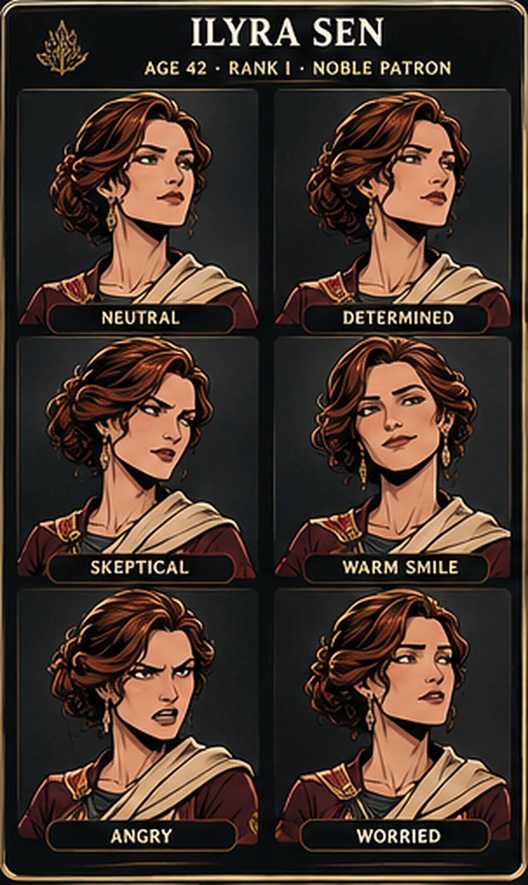
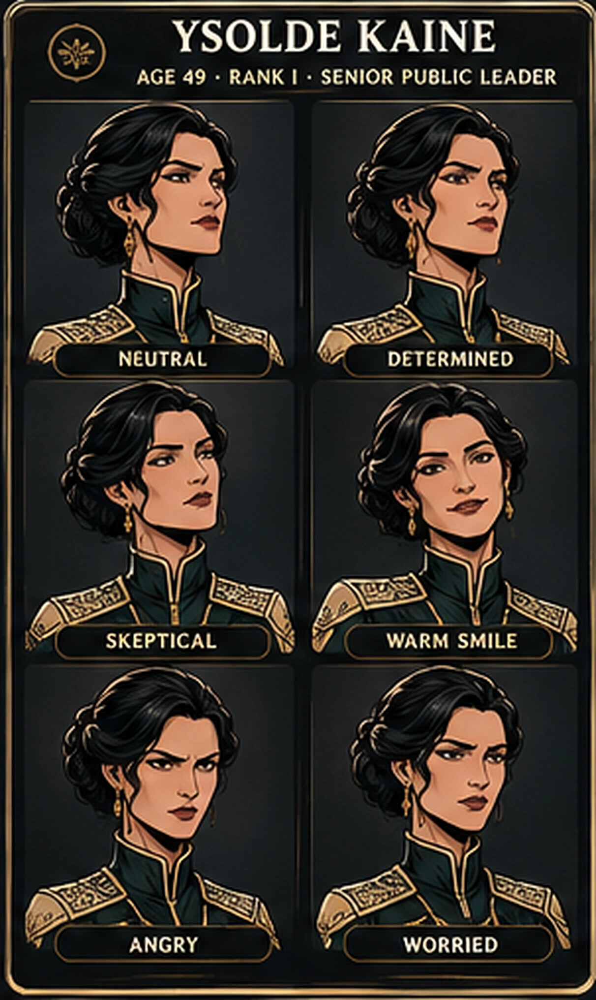
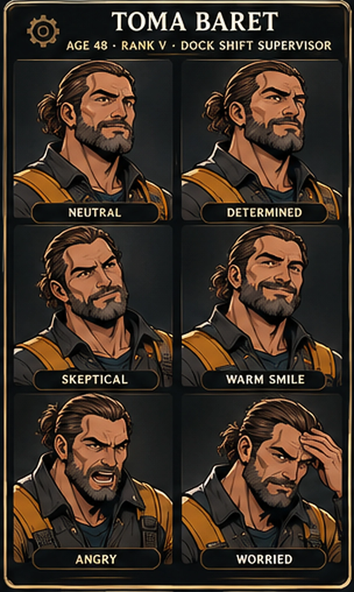
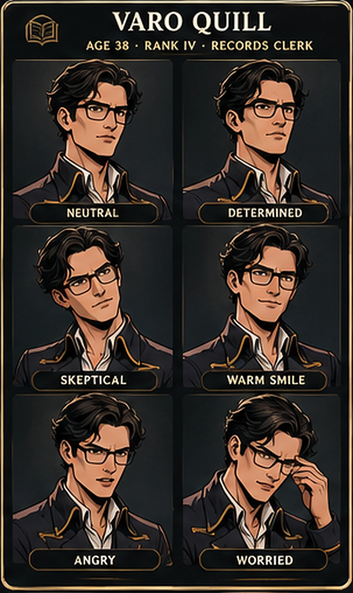
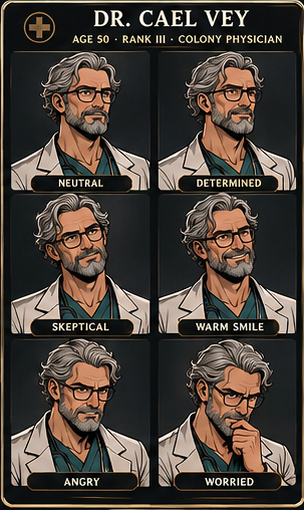
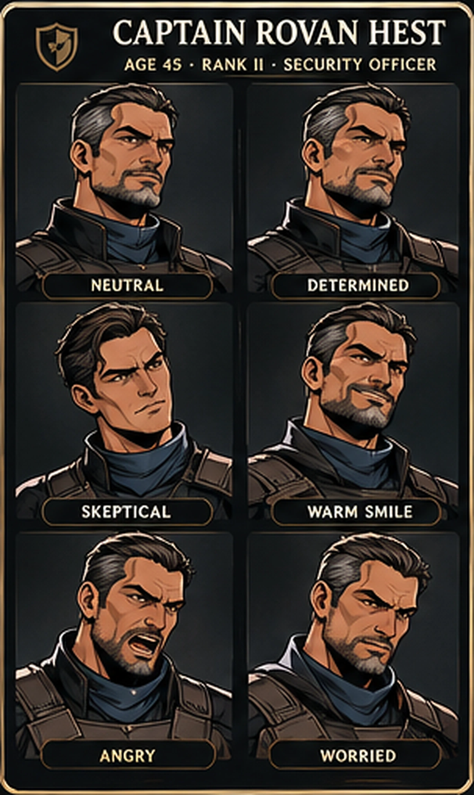
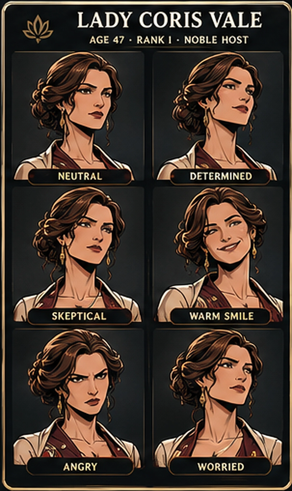
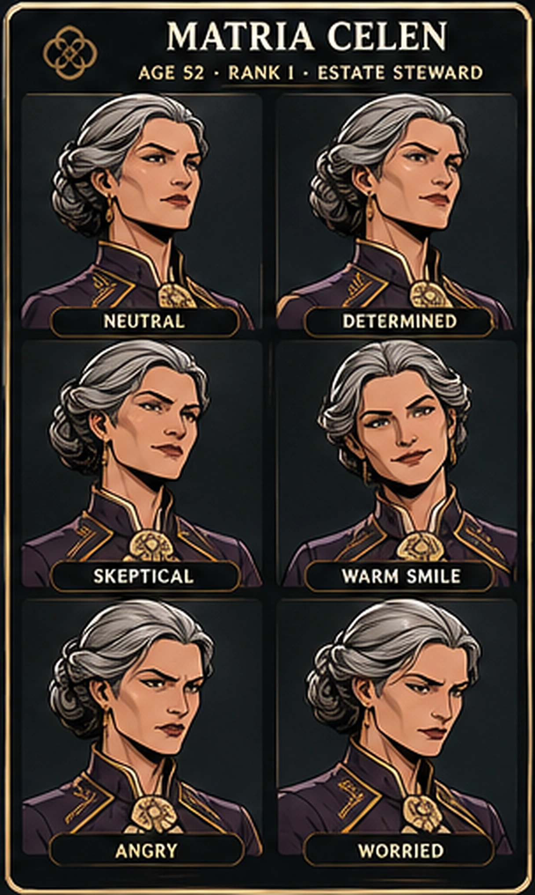
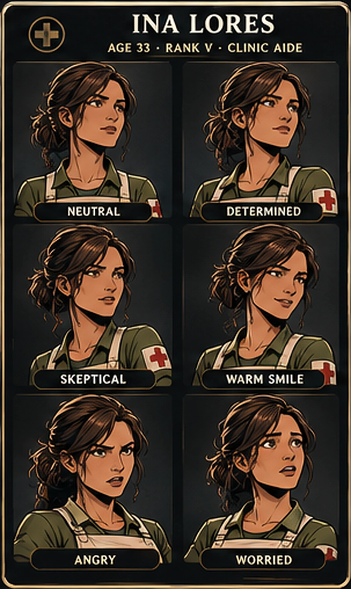
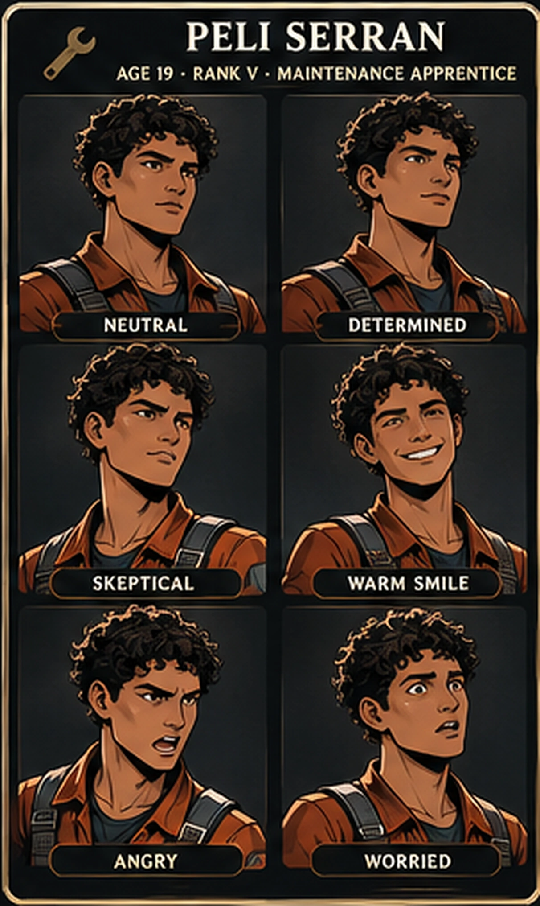

# TierFall — Six-expression portrait review set (11–20)

**Review only; not used by the live game.** These ten player-safe sheets preserve the public-facing character appearance and cover neutral, determined, skeptical, warm smile, angry, and worried expressions.

The images are approximately 1,212 × 2,032 pixels after careful 4× resampling from a combined 1,536 × 1,024 concept sheet. **These are upscaled HD-sized previews, not ten individually redrawn native-HD images.** Faces are limited by the original composite resolution. Keep the approved neutral game portraits unchanged until an explicit art-swap approval.

| Character | Review sheet |
|---|---|
| Ilyra Sen |  |
| Ysolde Kaine |  |
| Toma Baret |  |
| Varo Quill |  |
| Dr. Cael Vey |  |
| Captain Rovan Hest |  |
| Lady Coris Vale |  |
| Matria Celen |  |
| Ina Lores |  |
| Peli Serran |  |

No unreleased story detail, narrative reveal, or secret costume is included. To view original-quality previews, open the linked WebP files from this folder.
